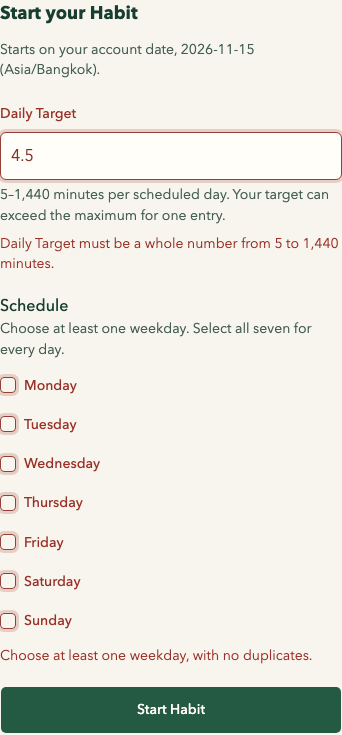

# Verification context and submission status

Prepared on 15 November 2026 (Asia/Bangkok) by Codex under the team's instruction to complete Deliverable 1. Students: **67070501063 Theeraphat Jaingam** and **67070501058 Chanya Poolketkij**. Repository: https://github.com/thrxpt/habitarc. Theme: Habit and Activity Tracking for student study/movement routines.

**REVIEW COPY: not yet an accepted main release.** Tested application candidate: `87ad604157c6d17f0a78b9b0c9b1c675e3b032b7`. This candidate extends Sprint 1 integration `0f24d8fec1f26676ce510f7aafa4fc4468ee43f1` with a calendar-validation regression/fix. Evidence capture adds screenshots to existing browser tests; no production credentials or development database records are used. The source-hash manifest identifies the exact tested code/test files. Documentation and PDF assembly do not change runtime behavior.

At the GitHub snapshot, `sprint-1` is `0f24d8fec1f26676ce510f7aafa4fc4468ee43f1`, while `main` is still starter `7993d06519211ce19d66a744689e0ef67cb09283`. There is no accepted release tag/commit to invent. Before submission, integrate this candidate through teammate review, run final checks on the accepted main commit, record its immutable reference, and regenerate the report. The PDF's page navigation is generated from the actual rendered pages.

Schedule and integration update, November 15: the user confirmed Lab 5's extension to November 22 in the Issue #8 work, recorded in commit `f0b61e2`. Only its deadline changes are carried into this preparation; PR #30's Docker/pipeline implementation remains separately open. The user accepted the sequence PR #31 -> local release PR #32 -> update/review PR #30 for Lab 5. The subsequent status check found passing CI and no teammate reviews on #31/#32. This update does not replace the dated GitHub evidence snapshot or claim acceptance. Required human setup/reproduction results remain pending under issue #9.

## Build and automated execution

All runs use the pinned Vite+ toolchain (local vite-plus 1.6.0, Vitest 5.1.0), Node 26.13.1, Bun 1.4.4, PostgreSQL 17, and synthetic generated accounts. The test database creator connects through `TEST_DATABASE_URL=postgresql://postgres@127.0.0.1:55432/habitarc_auth_test`; each integration/E2E fixture creates and later drops only its uniquely named disposable database. A local PostgreSQL Compose service already occupied port 55432, so the new worktree's attempted Compose start reported a port conflict; the existing healthy loopback service was used without stopping/resetting it. This is an environment setup event, not a hidden failed test.

| Command | Actual result | Retained output |
| --- | --- | --- |
| `vp install` | PASS; pinned dependencies installed, prepare hook executed | Tool execution; no dependency changes |
| `vp check` | PASS formatting, lint, type-aware checks | evidence/check.log |
| `vp run typecheck` | PASS TypeScript project | evidence/typecheck.log |
| `vp exec drizzle-kit check` | PASS migration journal | evidence/migrations.log |
| `vp test --run --passWithNoTests=false --reporter=verbose` | 92 passed; 0 failed; 0 skipped, across 10 files | evidence/vitest.log; full exact names |
| `vp run test:e2e` | 4 passed; 0 failed; 0 skipped, Chromium | evidence/playwright.log |
| `vp run build` | PASS client and server production bundles | evidence/build.log |

The final suite includes the new F02 calendar-cursor boundary regression (earlier Sprint 1 run: 91 tests). Playwright and Vitest are distinct suites. Selected raw excerpts below preserve commands/counts rather than inferring success from a test file's presence. Non-failing tool color warnings are retained in the logs.

### AC-to-execution results

All rows inherit the tested candidate, execution date, agent tester, and evidence paths above. `AC-Fxx-n` pairs one-to-one with `STS-Fxx-n`. Local PASS is a result at its stated test boundary; it does not imply whole-product completion, live cloud success, or human acceptance. Requirement IDs not allocated to Sprint 1 retain Part B's future allocation.

| AC / STS | Requirements | Actual tests / measurement | Result and boundary |
| --- | --- | --- | --- |
| AC-F01-1 / STS-F01-1 | FR-01; NFR-01 | tests/auth.integration.test.ts: two pre-provisioned Participants and a Program Manager sign in with server-owned identity; invalid credentials are generic for existing and unknown accounts. e2e/habit-setup.spec.ts: a Participant starts a private weekday Habit and retrieves it after reload and a new sign-in. | PASS integration + Chromium |
| AC-F01-2 / STS-F01-2 | FR-02; BR-01; NFR-01 | tests/auth.integration.test.ts: only login, current session, and logout are mounted; signup, recovery, and role changes cannot bypass this. tests/entries.integration.test.ts: TanStack Start enforces Today and entry recording authorization, idempotency, conflict serialization, and reload persistence over HTTP. | PASS currently implemented operations |
| AC-F01-3 / STS-F01-3 | FR-01; NFR-01 | tests/auth.integration.test.ts: production cookies expire in seven days and logout revokes the session on both instances; session reads stay read-only, trusted POST renews at most daily, and expiry is shared. | PASS two real DB pools |
| AC-F01-4 / STS-F01-4 | FR-02; NFR-01 | tests/auth.integration.test.ts: cross-origin and missing-origin writes fail before credentials or logout are processed; the eleventh login in a minute is throttled across replicas and forged forwarding prefixes cannot evade it; concurrent login requests cannot exceed ten admissions across independent pools. | PASS local/simulated headers; live ingress pending Lab 5 |
| AC-F02-1 / STS-F02-1 | FR-03; BR-02/12 | tests/templates.integration.test.ts: `Program Manager creates an Activity Template and Participant sees persisted details across independent pools`; `bounded keyset pagination returns every created template beyond 200 without skips or duplicates`. e2e/habit-setup.spec.ts: a Participant starts a private weekday Habit and retrieves it after reload and a new sign-in (manager creation then Participant selection). | PASS PostgreSQL + Chromium |
| AC-F02-2 / STS-F02-2 | FR-03; BR-02 | tests/templates.unit.test.ts: rejects unsupported units, non-integer bounds, zero/negative bounds, inverted ranges, and ceiling overflows; template cursors reject normalized impossible UTC dates while preserving valid microseconds. tests/templates.integration.test.ts: `invalid template definitions are rejected without partial writes and database constraints enforce bounds`. | PASS unit + real DB |
| AC-F02-3 / STS-F02-3 | FR-02/03; NFR-01 | tests/templates.integration.test.ts: `Participants cannot create templates directly through the template service`; `TanStack Start enforces template authorization, validation, and persisted reload visibility over HTTP`. | PASS integration |
| AC-F03-1 / STS-F03-1 | FR-04; BR-01/03/05/07/08 | tests/habits.integration.test.ts: Participant starts a persisted scheduled Habit with target 60 on a 5–45 minute template; Account Timezones determine start dates across the date line and caller timezone fields are ignored. e2e/habit-setup.spec.ts: private weekday Habit/reload/sign-in journey. | PASS integration + Chromium |
| AC-F03-2 / STS-F03-2 | FR-04; BR-03/04/12 | tests/habits.integration.test.ts: invalid Habit settings $dailyTarget $weekdays $templateId leave no partial Habit (13 inputs); missing/archived templates. e2e/habit-setup.spec.ts: a narrow-screen Participant corrects invalid settings and starts an every-day Habit. | PASS integration + rendered form + Chromium |
| AC-F03-3 / STS-F03-3 | FR-04; BR-11; NFR-02 | tests/habits.integration.test.ts: concurrent creates return one active Habit and direct overlapping periods are rejected; tomorrow's pending archive blocks today, and an ended Habit permits a fresh history. | PASS real DB concurrency |
| AC-F03-4 / STS-F03-4 | FR-04; BR-12; NFR-02 | tests/habits.integration.test.ts: a measurement edit waiting behind Habit creation cannot change the newly used template; template-lock race cases. Manager edit/archive is simulated using real SQL because F08 APIs are not implemented. | PASS storage invariant; F08 APIs not claimed |
| AC-F04-1 / STS-F04-1 | FR-05; BR-09/13 | tests/entries.integration.test.ts: AC-F04-1: multiple deliberate entries accumulate and show overachievement with fill capped at 100%. e2e/activity-entries.spec.ts: Participant records durable progress and safely retries lost responses and failed saves. | PASS integration + Chromium |
| AC-F04-2 / STS-F04-2 | FR-05; BR-06; NFR-02 | tests/entries.integration.test.ts: AC-F04-2: concurrent idempotent retry counts once, payload mismatch conflicts, and distinct keys create distinct entries; AC-F04-2: receipt and entry persist atomically, and auth/ownership run before receipt lookup. | PASS PostgreSQL concurrency |
| AC-F04-3 / STS-F04-3 | FR-05; BR-05/07/08/09 | tests/entries.integration.test.ts: AC-F04-3: account midnight, 7-day window, pre-start, post-archive, off-schedule, and DST/timezone independence. tests/entries.unit.test.ts: entry date eligibility enforces today, 6-day lookback, startDate, and exclusive archivedFrom. | PASS unit + integration |
| AC-F04-4 / STS-F04-4 | FR-05; BR-03/04; NFR-02 | tests/entries.integration.test.ts: AC-F04-4: concurrent ceiling writes cannot exceed 1,440 minutes or 1,000,000 counts, and rejected writes leave no receipt. | PASS real DB race + unit bounds |
| AC-F04-5 / STS-F04-5 | FR-05; NFR-04 | e2e/activity-entries.spec.ts: Participant records durable progress and safely retries lost responses and failed saves. tests/workspace-today.test.tsx: uncertainty/retry/form-close cases. | PASS Chromium + rendered form; 360px no overflow |
| AC-F05-1 / STS-F05-1 | FR-12; NFR-07 | tests/auth.integration.test.ts: repeat provisioning and migration preserve existing passwords, identities, and sessions; local account generation is private, concurrent-safe, and preserves working credentials on reruns. README command runs below. | PARTIAL: agent run passes; teammate clean setup/acceptance still required |
| AC-F05-2 / STS-F05-2 | FR-12; NFR-07 | Historical PR #25: required CI Validate deliberately failed in run 43592070147; mergeStateStatus BLOCKED; branch closed without merge. Source: docs/auth.md and GitHub run/PR. | PASS historical CI gate; no new deliberate failure |
| AC-F05-3 / STS-F05-3 | FR-12; NFR-06/07 | GCP deployed-image restart/retrieval, immutable digest and backup evidence. | NOT EXECUTED here; separate Lab 5 gate |
| AC-F05-4 / STS-F05-4 | NFR-08 | Trial credit/expiry, cost, IAM, migration runner and recovery operational review. | NOT EXECUTED here; separate Lab 5 gate |

## Selected program demonstrations

All images were produced by the existing Chromium tests against the tested candidate plus screenshot-capture changes. Accounts use Asia/Bangkok while Chromium uses America/Los_Angeles. Screenshots show synthetic data, not secrets. Cropped surfaces are captured directly by Playwright locators for readable evidence; captions state role, starting conditions, steps, expected and actual result.

### DEMO-01: normal journey and saved retrieval

F02/F03/F04; AC-F02-1, AC-F03-1, AC-F04-1/2/5. A Program Manager signs in and creates a Focused Study template (minutes, 5–45 per entry). Participant C signs in, starts an every-day Habit with target 60, saves two deliberate 25-minute entries, reloads and observes total 50. The third +25 is committed but its response is deliberately dropped; close/reopen preserves the request, and Retry save confirms the already stored result. Reload retrieves exactly three entries, total 75, actual percentage 125%, visual fill 100%. Expected and actual: no duplicate from the retry, persisted completed progress. The same automated journey simulates a separate 503, verifies unchanged storage in a fresh tab, then retries the identical request and retrieves total 85/four entries.


A separate private weekday-Habit journey starts target 60 with Monday–Friday, reloads, checks the existing-Habit rejection, signs out/switches accounts, then signs in again to retrieve the same Habit. Expected and actual: private persisted target/Schedule, with no second active Habit. Backend tests also read persisted rows through an independent pool, proving the UI is backed by PostgreSQL rather than browser-only state.


### DEMO-02: meaningful rule/boundary rejection

F03/F04; AC-F03-2, AC-F04-4. On a 5–45 minute template, Participant B submits Daily Target 4.5 and no weekdays. Expected and actual: associated whole-number/minimum and nonempty-weekday errors; no Habit is created. Correcting target to 60 and selecting every weekday by keyboard succeeds and survives reload. The pictured error is UI evidence; corresponding real-database tests submit invalid targets/ranges directly and verify no partial Habit/revision. F04's backend race below separately proves atomic rejection when two writes would exceed the daily ceiling.



### DEMO-03: login, logout, and backend forbidden operations

F01/F04; AC-F01-1/2/3, AC-F02-3. Participant A submits an incorrect password. Expected and actual: generic error without identity disclosure. Password is cleared before capture. A valid login displays the server-owned identity; Sign out returns the login form. Tests reuse revoked cookies across independent auth instances and reject them; expiry and cookie attributes are asserted separately.


The screenshot of a missing manager control is not the authorization proof. The passing HTTP integration journey calls the actual generated TanStack server functions: anonymous getToday/createEntry -> 401; manager getToday/createEntry -> 403; Participant B writing A's Habit -> 404; cross-origin write -> 403; invalid amount 4 on bounds 5–45 -> 400 with field errors. Auth integration additionally tests disabled signup/role mutation, missing-origin writes, shared login throttling, expiry, and logout/revocation. Actual assertions and passing test output are embedded below.

## Selected actual automated test excerpts

### Important domain rule: concurrent daily ceiling

Source: tests/entries.integration.test.ts, test `AC-F04-4: concurrent ceiling writes cannot exceed 1,440 minutes or 1,000,000 counts, and rejected writes leave no receipt`. Setup creates a Participant Habit using a 5–45 minute template, then stores 31 * 45 + 35 = 1,430 minutes in the real database. Two independent service/pool instances race +10 writes with distinct keys. The excerpt below is copied from the actual test; setup commentary is this caption rather than invented test code.

```typescript
const keyOne = randomUUID();
const keyTwo = randomUUID();
const results = await Promise.allSettled([
  entries.createEntry(participantA, {
    habitId: minuteHabit.id,
    activityDate: today,
    amount: 10,
    requestKey: keyOne,
  }),
  otherEntries.createEntry(participantA, {
    habitId: minuteHabit.id,
    activityDate: today,
    amount: 10,
    requestKey: keyTwo,
  }),
]);

const fulfilled = results.filter((result) => result.status === "fulfilled");
const rejected = results.filter((result) => result.status === "rejected");
expect(fulfilled).toHaveLength(1);
expect(rejected).toHaveLength(1);
expect(fulfilled[0]?.value.dailyTotal).toBe(1440);
expect(rejected[0]?.reason).toMatchObject({ status: 409 });

const todayAfterRace = await otherEntries.getToday(participantA);
expect(todayAfterRace.scheduled[0]?.progress.dailyTotal).toBe(1440);

// Rejected race contender left no receipt.
const receipts = await pool.query<{ count: string }>(
  "SELECT count(*) FROM mutation_receipt WHERE actor_id = $1 AND request_key IN ($2, $3)",
  [participantA.id, keyOne, keyTwo]
);
expect(Number(receipts.rows[0]?.count)).toBe(1);
```

Expected and actual: exactly one write succeeds at 1,440; one conflicts with 409; stored total remains 1,440 and only one race receipt exists. This test passes in the final 92-test run.

### Role/ownership restriction through the actual HTTP application

Source: tests/entries.integration.test.ts, `TanStack Start enforces Today and entry recording authorization, idempotency, conflict serialization, and reload persistence over HTTP`. Setup starts TanStack with the real isolated PostgreSQL database, signs in A/B/manager through `/api/auth/sign-in/email`, creates the template as manager and Habit as A, and retrieves the server's account date. `callServerFn` discovers actual generated transport IDs and deserializes the real response.

```typescript
expect(
  await callServerFn("getToday", {
    method: "GET",
    cookie: managerCookie,
  })
).toMatchObject({ status: 403 });

expect(
  await callServerFn("createEntry", {
    method: "POST",
    cookie: managerCookie,
    data: {
      habitId,
      activityDate: todayDate,
      amount: 25,
      requestKey: "m1",
    },
  })
).toMatchObject({ status: 403 });

expect(
  await callServerFn("createEntry", {
    method: "POST",
    cookie: otherCookie,
    data: {
      habitId,
      activityDate: todayDate,
      amount: 25,
      requestKey: "b1",
    },
  })
).toMatchObject({ status: 404 });
```

Expected and actual: manager access is 403; cross-Participant write is 404 without revealing private data. This is a passing HTTP/PostgreSQL test, not a mocked role selector. Complete setup/remaining assertions and names are retained in source/logs.

## Genuine TDD evidence and version history

The baseline contract/test-design files were recorded at `07f143a` (14 Nov 2026, 11:13:10 +07), with course alignment `03f2d40` (12:51:39 +07), before F01 implementation `41e0494` (14:39:33 +07). F03 implementation `5d93c31` followed on 15 Nov at 05:35:54 +07; browser design/verification expanded at `743b2a6` (14:51:17 +07). PR #27's review found confirmation/ARIA defects; the author's response reports both regressions failing before correction in `865310f`, and the teammate explicitly verified those corrections before approval. The original red terminal output for that historical feature work was not retained in this package; review testimony is not relabeled as a captured red log.

This preparation found the already-reviewed F02 cursor-date defect: JavaScript normalized 30 February and accepted it until PostgreSQL failed the cast, producing 503 instead of validation failure. This is a real validation correction under F02's bounded/predictable-error contract. The regression was written and executed first at the existing public `validateTemplateListQuery` boundary; its real red log and test were committed at `f3841fd`. The minimal correction then compared parsed UTC calendar components while retaining original microsecond precision. The same test passed and was committed at `87ad604`. Invalid 30-February/non-leap 29-February/31-April/24:00 cursors reject; valid leap-day and microsecond cursors remain accepted.

These red/green runs occurred now, on 15 Nov, without backdating or reconstructing earlier feature evidence. No claim is made that this pagination regression alone proves original domain-rule TDD for F03/F04. Earlier rule-test red logs remain a disclosed evidence limitation.

### tdd-red.log

```text
 FAIL  tests/templates.unit.test.ts > template cursors reject normalized impossible UTC dates while preserving valid microseconds
AssertionError: expected true to be false // Object.is equality

- Expected
+ Received

- false
+ true

 Test Files  1 failed (1)
      Tests  1 failed | 3 passed (4)
   Start at  22:19:33
   Duration  137ms (tests 42%, transform 37%, import 16%, worker 5%)

```

### tdd-green.log

```text
 ✓ tests/templates.unit.test.ts > template cursors reject normalized impossible UTC dates while preserving valid microseconds 0ms

 Test Files  1 passed (1)
      Tests  4 passed (4)
   Start at  22:19:52
   Duration  150ms (transform 53%, tests 28%, import 14%, worker 5%)

```

## Engineering workflow and teammate participation

Source: GitHub API snapshot evidence/github.json, captured at its recorded UTC timestamp; repository history retains authorship and actual commit dates. All sampled branches target sprint-1. The PR authors and reviewers are different GitHub accounts. Main integration is still pending and is explicitly not inferred from a closed feature Issue.

| Feature / Issue | Branch and PR | Author -> reviewer | Substantive review and integration |
| --- | --- | --- | --- |
| F01 / #4 | feat/auth-workspaces; PR #24 | thrxpt -> chanya06 | Ledger/version drift, dangling skills, named constants/shared components corrected; approved 14 Nov 17:59:44 UTC; merged sprint-1 as e00dd69 |
| F02 / #5 | feat/activity-templates; PR #26 | chanya06 -> thrxpt | First-200-template truncation blocked review; bounded keyset pagination + Load more corrected; approved 14 Nov 21:42:30 UTC; merged b63a7b1. Calendar cursor P3 is corrected by this candidate |
| F03 / #6 | feat/scheduled-habits; PR #27 | thrxpt -> chanya06 | Saved confirmation became duplicate warning after refresh; dangling ARIA IDs. Both fixed 865310f and explicitly verified in approval 15 Nov 10:02:47 UTC; merged 0a40e39 |
| F04 / #7 | feat/activity-entries; PR #28 | chanya06 -> thrxpt | Lost-response requests were discarded on close; separate failed-save coverage missing. Fix d13929e retains retries; original author hydration fix 454c6a3 retained; approved 15 Nov 13:47:15 UTC; merged 0f24d8f |

### Selected readable review evidence

PR #26; thrxpt; APPROVED; 2026-11-14T21:42:30Z; reviewed bbee3c3d3f7e45222f831ef1a65707e6a210641d.

Re-reviewed commits 3674362 and bbee3c3 and the author's follow-up comment.

The previous pagination blocker is resolved: bounded keyset pagination and the Load more control make templates beyond the first 200 accessible. The schema checks now use the shared validation constants. No blocking findings remain.

Nonblocking P3 — src/templates.ts:265: Date.parse normalizes impossible dates such as 2026-02-30T00:00:00.000000Z, allowing them through cursor validation. PostgreSQL rejects the timestamp cast, which the error middleware maps to 503 rather than 400. Consider checking calendar components while preserving microsecond precision. Normal server-generated cursors are unaffected.

Verification: GitHub Actions CI run 17 passed for bbee3c3d3f7e45222f831ef1a65707e6a210641d. I also ran the current cursor validator locally and confirmed PostgreSQL rejects the impossible date using a read-only SELECT. I did not rerun the full test suite locally.

Approved.

PR #27; chanya06; APPROVED; 2026-11-15T10:02:47Z; reviewed 865310fa58e194ede20a4a8b511ebccd57d29f77.

Verified `865310f` — both blockers from the previous review are fixed and well covered by the new Vitest and Playwright regressions:

- **Post-creation confirmation**: `result?.kind === "created" && result.habit.id === saved.id` keeps `"Your Habit is saved."` intact after `router.invalidate()`, and the E2E journey now asserts it directly.
- **ARIA descriptions**: `aria-describedby` includes `habit-target-error` / `habit-weekdays-error` only when defined, and the new regression checks target existence before validation, on error, and after correction.

Approving to unblock merge. A couple of minor non-blocking follow-ups to keep on the radar (or address in a small follow-up):

- **Verification ledger consistency (`docs/sprints/README.md`)**:
  - `docs/auth.md` removes `AC-F01-1 / STS-F01-1 browser E2E` from Open acceptance gates, but the `#f01-verification-ledger` rows (L78, L83) still say `browser E2E INCOMPLETE`.
  - `docs/habits.md` uses a 2-column summary table rather than the full verification ledger columns (`requirement ID, feature/AC/STS ID, actual test file/name or measurement, execution status, commit, CI/run or evidence reference, tester, date`).
- **Remaining open coverage**: `NFR-04` (`360px` viewport, zero horizontal overflow, `200%` zoom) and `AC-F03-2` stale-UI submission against an archived template (currently covered at the service/DB layer).
- **Previously noted non-blocking cleanups**: `Habit.goal` → `goalRevision` (`GLOSSARY.md`), named constants in `src/habits.ts` (`200`, `WEEKDAYS.length`), shared active-Habit predicate, and moving the Habit HTTP tests out of `tests/templates.integration.test.ts`.

### Board snapshot and contributions

GitHub Project: https://github.com/users/thrxpt/projects/13. At capture: Issues #4/#5/#6/#7 Done (and CLOSED); #8 Ready (OPEN); #9 Backlog (OPEN); product spec #3 Backlog; later Sprint 2/3 and maintenance items Backlog. These are actual current fields, not a claimed completed Sprint 1 board. Issue #9 remains the release/reproduction handoff. The board must be refreshed after actual release acceptance.

| Student | Recorded concrete contributions | Evidence |
| --- | --- | --- |
| 67070501063 Theeraphat Jaingam / thrxpt | Planning baseline, F01 auth/provisioning/CI, F03 Habit implementation and fixes; reviewed F02/F04; preserved retry-state fix and follow-up tests in F04 | PR #23/#24/#27 authorship; #26/#28 reviews; commits 865310f/d13929e |
| 67070501058 Chanya Poolketkij / chanya06 | F02 template and F04 Activity Entry implementation/tests; hydration fix; substantive F01/F03 review with findings and verified fixes | PR #26/#28 authorship; #24/#27 reviews; commit 454c6a3 |

The user supplied both names/IDs for this report. Contributions above are limited to observable GitHub evidence. No unrecorded pair session, teammate clean setup, or human release acceptance is claimed.

AI-use declaration: AI agents assisted with requirements/design documents, code, test development, review analysis, and this evidence/PDF preparation. GitHub PRs retain authorship/review context. This report's fresh commands and assembly were executed by Codex, not an independent student tester. Students remain responsible for validating the work and explaining the design, tests, and released behavior.

## Reproduction summary and safe access

Install pinned tooling, copy `.env.example` to ignored `.env.local`, set a private random auth secret of at least 32 characters and canonical origin http://localhost:3000, start PostgreSQL, migrate, generate local synthetic accounts, and run the app. Existing PostgreSQL on the same loopback port can service disposable fixtures; do not stop another worktree's database or erase its volume. `btree_gist` installation and test database creation privileges are required. Full README remains in the repository.

```sh
vp install
cp .env.example .env.local
chmod 600 .env.local
# Privately set BETTER_AUTH_SECRET; do not print it in evidence.
docker compose up -d --wait postgres
vp run db:migrate
vp run accounts:local
vp run dev
# In a separate shell, export the disposable TEST_DATABASE_URL.
vp check
vp run typecheck
vp exec drizzle-kit check
vp test --run --passWithNoTests=false
vp exec playwright install chromium
vp run test:e2e
vp run build
```

`accounts:local` provisions one@example.test/two@example.test Participants and manager@example.test Program Manager with generated passwords in ~/.local/share/habitarc/local-accounts.json (0600). That private file is outside the repository; do not embed its contents or any password/token in this PDF. Reruns preserve existing credentials. Browser tests instead provision their own synthetic accounts and random credentials in an isolated database. PostgreSQL's named Compose volume survives app restarts and ordinary compose down. Never remove production/assessed storage to repeat a test.

## Known incomplete work and submission gates

1. Teammate review/integration of this evidence and F02 correction; fresh verification on the final integrated commit. Passing local agent checks do not replace teammate review.
2. Teammate clean README setup, migration/seed/re-run, saved retrieval, and acceptance record (AC-F05-1). Automated operator tests pass but do not fulfill the human acceptance criterion.
3. Reviewed staging-to-main release, immutable release reference/tag, final board status, and final-commit command results. Main is still the starter at capture. This package cannot be submitted as a completed release until that gate is closed.
4. Historical domain-rule red logs were not found. Actual baseline-before-code chronology, teammate review testimony, current domain tests, and the new actual F02 red/green logs are retained without pretending to recreate original TDD.
5. Full WCAG automation/manual screen-reader assessment, 200% zoom and the specified workload/performance measurements remain unexecuted here. Existing keyboard/labels/error associations and 360px/390px Chromium journeys are scoped evidence; they do not certify every NFR. Final integrated measurement remains allocated in Parts A/B/D.
6. Cloud ingress, Docker/GCP delivery, backup/restore, budget and access continuity remain Lab 5/later operational work in issue #8, outside the Deliverable 1 local application requirement. Open delivery PRs are not treated as merged or deployed evidence.
7. F06–F12 and the approved maintenance exercise are later work in the three-sprint baseline. No skipped/disabled test is used to hide them. Final automated runs have zero failing/skipped tests; the intentional TDD red run is separately labeled above.

## External evidence references

Repository: https://github.com/thrxpt/habitarc. Selected Issues: /issues/4, /issues/5, /issues/6, /issues/7, /issues/9. Selected reviewed PRs: /pull/24, /pull/26, /pull/27, /pull/28 (all relative to that repository URL). Required-check failure: https://github.com/thrxpt/habitarc/actions/runs/43592070147 and https://github.com/thrxpt/habitarc/pull/25. Earlier F01 passing run: https://github.com/thrxpt/habitarc/actions/runs/43619543768. These URLs support targeted verification; all assessed engineering content and selected execution/review evidence appear directly in this PDF.

## Selected actual command output

### check.log

```text
note: You are running `vp check` as a Vite+ built-in command. If you meant to run the check npm script, use `vpr check` instead.
pass: All 122 files are correctly formatted (556ms, 10 threads)
pass: Found no warnings, lint errors, or type errors in 62 files (1.3s, 10 threads)
```

### typecheck.log

```text
$ tsc --noEmit ⊘ cache disabled
```

### migrations.log

```text
No config path provided, using default 'drizzle.config.ts'
Reading config file '/Users/thrxpt/.t3/worktrees/habitarc/t3-b1e2232b-af9c2957e0670e2c/drizzle.config.ts'
Everything's fine 🐶🔥
```

### vitest.log

```text
 ✓ tests/templates.unit.test.ts > template cursors reject normalized impossible UTC dates while preserving valid microseconds 1ms
 ✓ tests/entries.integration.test.ts > AC-F04-4: concurrent ceiling writes cannot exceed 1,440 minutes or 1,000,000 counts, and rejected writes leave no receipt 201ms
 ✓ tests/entries.integration.test.ts > TanStack Start enforces Today and entry recording authorization, idempotency, conflict serialization, and reload persistence over HTTP 3861ms

 Test Files  10 passed (10)
      Tests  92 passed (92)
   Start at  22:21:02
   Duration  21.28s (tests 72%, import 17%, environment 7%, transform 4%)

```

### playwright.log

```text
  ✓  1 [chromium] › e2e/activity-entries.spec.ts:44:1 › Participant records durable progress and safely retries lost responses and failed saves (5.8s)
  ✓  2 [chromium] › e2e/habit-setup.spec.ts:41:1 › sign-in cannot submit before hydration and its fallback uses POST (159ms)
  ✓  3 [chromium] › e2e/habit-setup.spec.ts:59:1 › a Participant starts a private weekday Habit and retrieves it after reload and a new sign-in (3.6s)
  ✓  4 [chromium] › e2e/habit-setup.spec.ts:157:1 › a narrow-screen Participant corrects invalid settings and starts an every-day Habit (2.2s)

  4 passed (16.8s)

```

### build.log

```text
$ vp build ⊘ cache disabled
✓ built in 819ms
✓ built in 336ms
```
